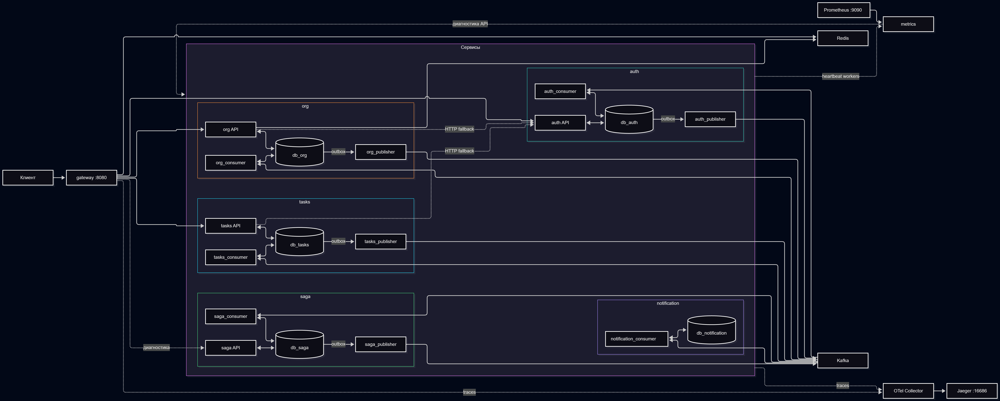
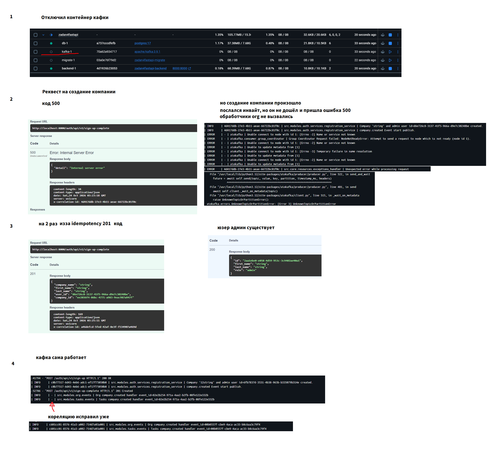
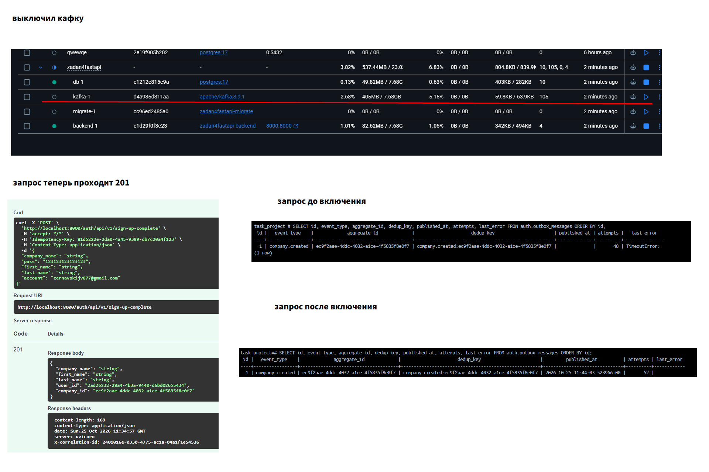
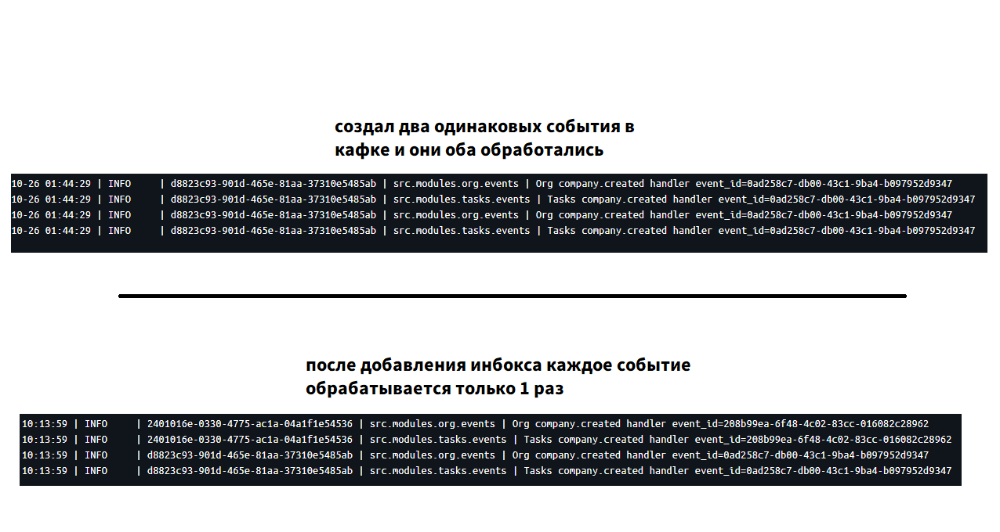
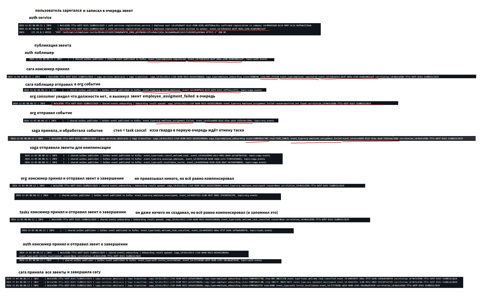

## Содержание

- [Архитектура](#архитектура)
- [Запуск проекта](#запуск-проекта)
- [Переменные окружения](#переменные-окружения)
- [Тесты и проверки](#тесты-и-проверки)
- [Запросы через Postman](#запросы-через-postman)
- [События](#события)
- [Правила совместимости Event contracts](#правила-совместимости-event-contracts)
- [Паттерн → где в коде](#паттерн--где-в-коде)
- [Подразделения](#подразделения)
- [Артефакты](#артефакты)

## Архитектура



| Сервис | Назначение |
| --- | --- |
| gateway | Общий вход в API, Swagger, проверка JWT и ограничение запросов |
| auth | Регистрация, приглашения, пользователи и JWT |
| org | Подразделения, должности и назначения сотрудников; кэш в Redis |
| tasks | Задачи и переходы статусов |
| saga | Оркестрация онбординга и компенсаций |
| notification | Читает события и пишет уведомления в лог |
| metrics | Собирает диагностику API и heartbeat workers для Prometheus |

У auth/org/tasks/saga/notification свои PostgreSQL и миграции. У auth/org/tasks/saga API, consumer и publisher работают отдельными процессами; notification запускает только consumer. Общие механизмы — в [shared](shared/shared).

## Запуск проекта

Нужны Git и Docker с Compose v2. Команды выполняются из корня проекта.

```shell
git clone https://github.com/sqqqwer/Zadan4FastApi.git
cd Zadan4FastApi
```

Скопируйте настройки сервисов (PowerShell):

```powershell
Copy-Item services/auth/.env.example services/auth/.env
Copy-Item services/org/.env.example services/org/.env
Copy-Item services/tasks/.env.example services/tasks/.env
Copy-Item services/saga/.env.example services/saga/.env
Copy-Item services/notification/.env.example services/notification/.env
Copy-Item services/gateway/.env.example services/gateway/.env
Copy-Item services/metrics/.env.example services/metrics/.env
```

Задайте пароли БД, `IDEMPOTENCY_HMAC_SECRET` и `FRONTEND_URL` в файлах сервисов. В Compose используются учебные RS256-ключи из `keys/`; свои ключи подключаются через `secrets` в [docker-compose.yml](docker-compose.yml).

```shell
docker compose up -d --build
```

Миграции применяются автоматически перед запуском сервисов.

- [Swagger](http://localhost:8080/docs) — общий API: `/auth/api/v1`, `/org/api/v1`, `/tasks/api/v1`.
- [Prometheus](http://localhost:9090) — метрики; [Jaeger](http://localhost:16686) — трассировка.
- Диагностика: `GET /{service}/operations/{health|ready|outbox|consumer-lag}`, зависшие саги — `GET /saga/operations/stalled` через gateway.

## Переменные окружения

Примеры: [auth](services/auth/.env.example), [org](services/org/.env.example), [tasks](services/tasks/.env.example), [saga](services/saga/.env.example), [notification](services/notification/.env.example), [gateway](services/gateway/.env.example), [metrics](services/metrics/.env.example).

| Переменная | Назначение |
| --- | --- |
| `POSTGRES_USER`, `POSTGRES_PASSWORD`, `POSTGRES_DB` | Пользователь, пароль и БД сервиса |
| `DB_HOST`, `DB_PORT` | Адрес БД; в Compose `db_auth` / `db_org` / `db_tasks` / `db_saga` / `db_notification`, порт `5432` |
| `KAFKA_BOOTSTRAP_SERVERS` | Адрес Kafka; в Compose `kafka:9092` |
| `FRONTEND_URL` | Базовый URL для ссылок приглашений |
| `JWT_PRIVATE_KEY_PATH` | Путь к приватному RS256-ключу auth |
| `JWT_PUBLIC_KEY_PATH` | Путь к публичному ключу auth/org/tasks/gateway |
| `JWT_ALGORITHM`, `JWT_ISSUER`, `JWT_AUDIENCE` | Алгоритм и claims JWT; должны совпадать у сервисов |
| `IDEMPOTENCY_HMAC_SECRET` | Секрет отпечатка запроса для `Idempotency-Key` |
| `AUTH_BASE_URL` | Адрес auth для gateway и HTTP fallback org/tasks; в Compose `http://auth:8000` |
| `ORG_BASE_URL`, `TASKS_BASE_URL`, `SAGA_BASE_URL` | Адреса сервисов для gateway; в Compose `http://<service>:8000` |
| `AUTH_USERS_LOOKUP_PATH` | Путь fallback: `/auth/api/v1/users/lookup` |
| `AUTH_HTTP_TIMEOUT` | Таймаут fallback, по умолчанию `2` секунды |
| `UPSTREAM_HTTP_TIMEOUT` | Таймаут запросов к сервисам: gateway — `10`, metrics — `5` секунд |
| `ALLOWED_HOSTS` | Разрешённые Host-заголовки, JSON-массив |
| `REDIS_URL` | Redis для gateway и org; в Compose `redis://redis:6379/0` |
| `STRUCT_CACHE_TTL` | Время жизни кэша подразделений, по умолчанию `60` секунд |
| `RATE_LIMIT_MAX_REQUESTS`, `RATE_LIMIT_WINDOW_SECONDS` | Лимит gateway: по умолчанию `100` запросов за `60` секунд |
| `SAGA_STEP_TIMEOUT_SECONDS` | Порог зависшего шага, по умолчанию `60` секунд |
| `SAGA_TIMEOUT_CHECK_INTERVAL_SECONDS` | Интервал проверки зависших саг, по умолчанию `10` секунд |
| `STATISTICS_ENDPOINT` | Адрес приёма heartbeat workers: `http://metrics:8000/heartbeat` |
| `HEARTBEAT_INTERVAL_SECONDS`, `HEARTBEAT_TIMEOUT_SECONDS` | Интервал и таймаут heartbeat: `5` и `1` секунда |
| `SERVICE_URLS` | JSON-словарь адресов API для сбора метрик |
| `WORKERS` | JSON-словарь ожидаемых workers по сервисам: `consumer` / `publisher` |
| `UPSTREAM_MAX_CONCURRENCY` | Число параллельных запросов metrics, по умолчанию `10` |
| `TRACING_ENABLED` | Включение трассировки; в примерах `.env` — `true` |
| `TRACING_ENDPOINT` | OTLP HTTP endpoint: `http://otel-collector:4318/v1/traces` |
| `TRACING_SAMPLE_RATIO` | Доля сохраняемых трасс, от `0` до `1`; по умолчанию `1.0` |
| `TRACING_TIMEOUT_SECONDS` | Таймаут экспорта трасс, по умолчанию `3` секунды |
| `TRACING_EXCLUDED_URLS` | Регулярное выражение путей API, исключённых из трассировки |

## Тесты и проверки

Тесты с PostgreSQL и миграциями:

```shell
docker compose -f docker-compose.test.yml run --rm --build tests
```

Через Makefile: `make test` — тесты, `make check` — Ruff без изменений, `make prepare` — форматирование, автоисправления, тесты и очистка кэшей.

## Запросы через Postman

Импортируйте [коллекцию](postman/tasks-platform.postman_collection.json): запросы уже настроены на gateway `http://localhost:8080`.

## События

Топик — `<producer>.events`, ключ Kafka — `aggregate_id`; текущие продюсеры публикуют `schema_version=1`.

### Обычные события

| Тип события | Топик | Публикует | Обрабатывает | Эффект |
| --- | --- | --- | --- | --- |
| `company.created` | `auth.events` | auth | org, tasks | Снимок администратора в `users_replica` |
| `employee.created` | `auth.events` | auth | org, tasks | Снимок сотрудника в реплике |
| `employee.registered` | `auth.events` | auth | org, tasks, saga, notification | Обновление реплик, старт онбординга, уведомление в лог |
| `employee.email_changed` | `auth.events` | auth | org, tasks, notification | Обновление снимка без хранения email; уведомление в лог |
| `task.status_changed` | `tasks.events` | tasks | auth, notification | Запись изменения статуса в лог |

### Команды и события саги

| Тип события | Топик | Публикует | Обрабатывает | Эффект |
| --- | --- | --- | --- | --- |
| `org.assign_employee` | `saga.events` | saga | org | Назначение сотрудника на должность в подразделении |
| `org.employee_assigned` | `org.events` | org | saga | Переход к созданию приветственной задачи |
| `org.employee_assignment_failed` | `org.events` | org | saga | Начало компенсации |
| `tasks.create_welcome_task` | `saga.events` | saga | tasks | Создание приветственной задачи |
| `tasks.welcome_task_created` | `tasks.events` | tasks | saga | Завершение саги |
| `tasks.welcome_task_creation_failed` | `tasks.events` | tasks | saga | Начало компенсации |
| `tasks.cancel_welcome_task` | `saga.events` | saga | tasks | Отмена задачи или сохранение маркера отмены |
| `tasks.welcome_task_cancelled` | `tasks.events` | tasks | saga | Переход к откату назначения |
| `org.unassign_employee` | `saga.events` | saga | org | Откат назначения этой саги |
| `org.employee_unassigned` | `org.events` | org | saga | Переход к инвалидированию приглашения |
| `auth.invalidate_invite` | `saga.events` | saga | auth | Инвалидирование приглашения |
| `auth.invite_invalidated` | `auth.events` | auth | saga | Завершение компенсации |

## Правила совместимости Event contracts

- Необязательные поля можно добавлять без смены версии; удаление, переименование и новые обязательные поля требуют нового `schema_version`.
- Сначала consumer поддерживает обе версии, затем обновляется producer; старую версию убираем после обработки накопленных событий.
- Сейчас tasks принимает v1/v2 для `company.created` и `employee.created`, остальные контракты — v1.

## Паттерн → где в коде

| Паттерн | Реализация |
| --- | --- |
| Repository / Service Layer | [repositories](services/auth/auth/repositories), [services](services/auth/auth/services); аналогично в org/tasks/saga |
| UoW | [service](shared/shared/uow/service.py), [session_scope](shared/shared/uow/session_scope.py) |
| Dependency Injection | [dependencies](services/auth/auth/dependencies) в сервисах, FastAPI `Depends` |
| Публичные DTO | [auth](services/auth/auth/public/dto.py), [org](services/org/org/public/dto.py), [tasks](services/tasks/tasks/public/dto.py) |
| Ports & Adapters | [org port](services/org/org/ports.py), [tasks port](services/tasks/tasks/ports.py), [org adapters](services/org/org/adapters), [tasks adapters](services/tasks/tasks/adapters) |
| Transactional Outbox / Inbox | [outbox](shared/shared/outbox), [inbox](shared/shared/inbox), [Kafka consumer](shared/shared/events/kafka_adapters.py) |
| Event Contracts / Retry / DLQ | [envelope](shared/shared/events/envelope.py), [Kafka adapters](shared/shared/events/kafka_adapters.py), [DLQ](shared/shared/events/dlq.py) |
| Saga / Orchestrator | [saga service](services/saga/saga/services/saga_service.py), [org](services/org/org/services/onboarding_service.py), [tasks](services/tasks/tasks/services/onboarding_service.py), [auth](services/auth/auth/services/onboarding_service.py) |
| HTTP Idempotency-Key | [idempotency](shared/shared/idempotency) |
| API Gateway | [proxy](services/gateway/gateway/utils/proxy.py), [общий OpenAPI](services/gateway/gateway/utils/openapi.py) |
| Cache-Aside / Инвалидация | [кэш подразделений](services/org/org/services/struct_cache.py), [Redis cache](shared/shared/redis/cache.py) |
| Rate Limiting / Sliding Window | [Redis limiter](shared/shared/redis/rate_limiter.py), [gateway dependency](services/gateway/gateway/dependencies/rate_limiter.py) |
| Correlation / Logging / Tracing | [correlation](shared/shared/correlation), [logging](shared/shared/logging), [tracing](shared/shared/tracing) |
| Heartbeat / Метрики | [statistics](shared/shared/statistics), [metrics service](services/metrics/metrics/services/metrics_service.py), [алерты](services/metrics/alerts.yml) |
| Обработка ошибок | [exception handlers](shared/shared/resources/exceptions_handler.py) |

## Подразделения

- Подразделение нельзя удалить, пока у него есть должности.
- Перенос ветки под собственного потомка возвращает `StructMoveTargetInSubTree`, HTTP 409.

## Артефакты

### 1. Kafka недоступна: до и после Outbox

Что ломал: отключил Kafka и послал реквест на создание компании. Компания создалась, транзакция закоммитилась, но вернулась ошибка 500 из-за того, что не получилось отправить эвент через Kafka, и другие сервисы ничего не увидели.

Чем починил: очередью эвентов на публикацию (outbox). Запись в outbox создаётся в одной транзакции с созданием компании.

Как проверил: также отключил Kafka. Компания создалась успешно, с кодом 201. После включения Kafka паблишер отправил эвент в Kafka.

До Outbox:

После Outbox:


### 2. Повторная доставка: Inbox
Что ломал: создал два одинаковых эвента в Kafka, и они оба обработались в двух сервисах.

Чем починил: Inbox. Запомнил присланный эвент и записал его в базу.

Как проверил: создал два одинаковых эвента в Kafka, и они обработались по одному разу в каждом сервисе.

Повторная доставка до и после Inbox:


### 3. Ошибка шага: компенсация саги
Что ломал: удалил должность, указанную в эвенте.

Полный путь саги онбординга:


### 4. Eventual consistency
HTTP fallback удобнее для клиента.
Создаёшь компанию и сразу с ней работаешь, а не ждёшь каких-то непонятных для клиента повторов и ошибок.
